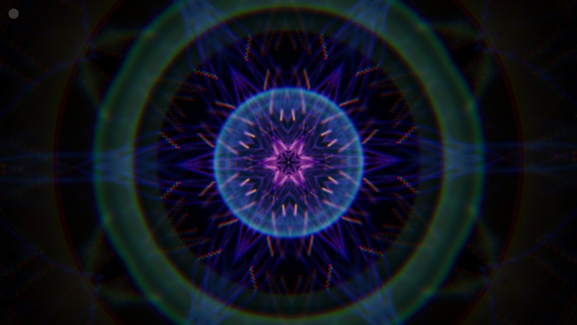

# Drift

> ⚠️ **Heads up:** this is AI vibe-coded (built with Claude) by a dumbass who has no idea what he's doing. Use at your own risk; no warranty, no promises.

A trippy music visualizer for Windows, in the spirit of the old Winamp-era feedback
visualizers. It listens to whatever Windows is playing and draws it with GPU feedback
effects: zooming, swirling trails, waveforms, kaleidoscopes and colour drift.

The look is never fixed. Each song starts simple and builds up. Over the first few minutes
of music, new layers unlock one at a time (spectrum ring, swirl, tunnel rings, sparkles,
orbs, chromatic split, echo), and the whole look keeps drifting. When the music changes
character (a drop, a breakdown), the scene mutates. When a song ends and a new one starts,
a new "species" is born.


| Start of a song | A minute in | A few minutes in |
|---|---|---|
|  |  |  |

**Download:** [drift-viz.exe](https://trolanin.github.io/drift-viz/drift-viz.exe). It's a
single file with no installer. It needs 64-bit Windows 10 or 11 and a DirectX 11 GPU.
Windows SmartScreen may warn you because the file isn't signed. Click "More info", then "Run anyway".

## Windows

- **Settings window.** The settings sit on the left and the visualizer is docked on the right.
  Drag the divider between them to resize the settings column. The window itself resizes like
  any other.
- **Undocked.** Click "Undock visualizer", or double-click the docked picture. The visualizer
  then becomes its own borderless window with nothing but the picture and a faint dot in the
  top-left corner.
  - Drag the dot to move the window.
  - Drag any edge or corner to resize it.
  - Double-click the dot to fill the screen, and again to go back.
  - Right-click for a menu.
  - Closing it docks it back.
- **Visualizer size.** Type a width × height in the settings and click Apply. This works docked
  or undocked.
- **Grip dot opacity.** This slider sets how visible the dot is. It brightens when the mouse is over it.

## Keys (with the visualizer focused)

| Key | Does |
|---|---|
| F or F11 | Fill screen / leave fill screen |
| Esc | Leave fill screen |
| D | Dock / undock |
| M | Mutate now |
| N | New species (start over from a fresh random look) |
| L | Keep this look as a favourite |
| Space | Freeze / unfreeze evolution |

## Settings

| Setting | What it does |
|---|---|
| Listen to | "What Windows is playing" (loopback of your default output device), or a built-in demo beat |
| Reactivity | How hard the music pushes the motion |
| Evolution speed | How fast the look drifts, and how often it makes small changes |
| Mutation strength | How much a scene change alters |
| Max scene length | The longest a scene lasts before it mutates on its own |
| Build-up time | Minutes of music to go from simple to full complexity |
| Max complexity | Caps how many layers can unlock |
| Freeze evolution | Holds the current look (it still reacts to the music) |
| Keep this look | Saves the look as a favourite. New species are sometimes bred from favourites. |
| Trails | Shorter or longer feedback trails |
| Brightness | Overall exposure. The picture also auto-adjusts so stacked layers don't wash out to white. |
| Render resolution | 50% / 75% / 100% of the window, for slower GPUs |
| Undocked window stays on top | Keeps the borderless window above other windows |

Settings and favourites are saved in `%APPDATA%\DriftViz\`.

## How the evolution works

- **Genes.** About 40 continuous parameters ("genes") cover zoom, rotation, swirl, warp,
  decay, palette, waveform shape, kaleidoscope, echo and more. Each one wanders on a slow,
  damped random walk inside a range that widens as complexity grows.
- **Choices.** Discrete choices (waveform shape, number of copies, kaleidoscope folds, mirror
  mode, tunnel shape) cross-fade between options instead of popping.
- **Complexity.** Complexity rises while music plays and unlocks layers at set thresholds. It
  drains during silence.
- **Scene mutations.** A mutation happens when the music changes character (the octave-band
  energy profile of the last half second drifts away from the last eight), or when the scene
  timer runs out. Beats add small nudges.
- **New species.** After more than 4 seconds of silence (a new song), a new species is born and
  complexity resets. Half the time it is bred from your kept favourites, by crossover plus a little mutation.

## Building

You need Visual Studio 2022 or its Build Tools, with the C++ workload and a Windows 10/11 SDK.
Then run:

```
build.bat
```

It compiles the shaders with `fxc` into `build\`, then builds `drift-viz.exe` with `cl`
(static CRT, no dependencies beyond Windows). Plain C++17, Win32, Direct3D 11 and WASAPI.
It has no frameworks.

| File | What's in it |
|---|---|
| `src/main.cpp` | Windows, settings UI, docking, borderless window, keys, settings file |
| `src/render.cpp` | Render thread: D3D11 setup, feedback buffers, frame pacing, screenshots |
| `src/shaders.hlsl` | Warp/feedback pass, waveform lines, composite (kaleidoscope, echo, tone map) |
| `src/evolve.cpp` | The evolution engine and the mapping from genes and audio to shader parameters |
| `src/audio.cpp` | WASAPI loopback capture, FFT analysis, beat / section / silence detection, demo beat |
| `src/params.h` | Shader parameter slots shared by C++ and HLSL |

### Command-line options (for testing)

| Option | Does |
|---|---|
| `--demo` | Use the built-in demo beat |
| `--docked` / `--undocked` | Start docked or undocked |
| `--size WxH` | Visualizer size in pixels |
| `--evo-scale K` | Run the evolution K times faster |
| `--shot file.png` | Save a screenshot and quit. Starts without taking focus, and implies `--no-save`. |
| `--shots N --after S --every S` | Take N screenshots: the first after S seconds, then one every S seconds (`file-1.png` …) |
| `--log path` | Append fps, audio and evolution state once a second |
| `--no-save` | Don't write settings on exit |
