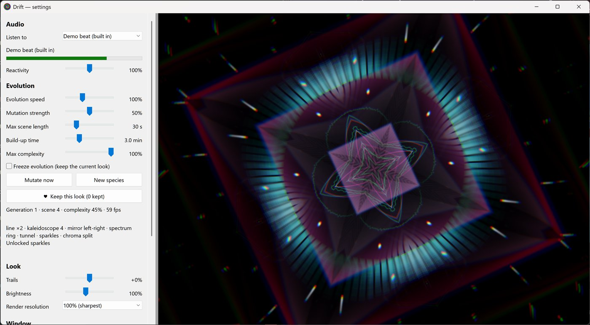
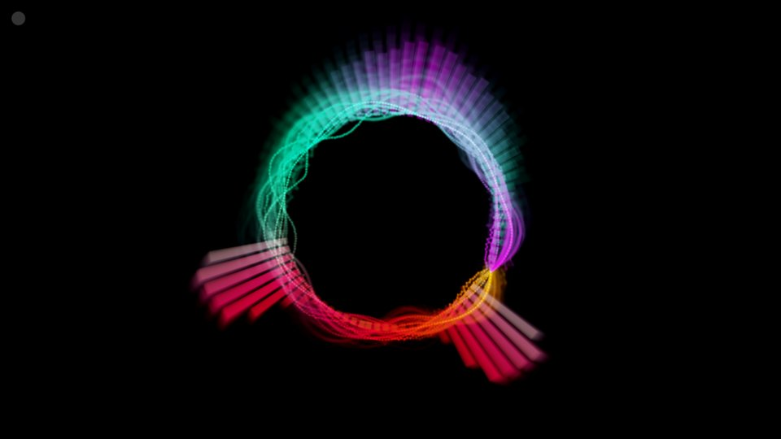
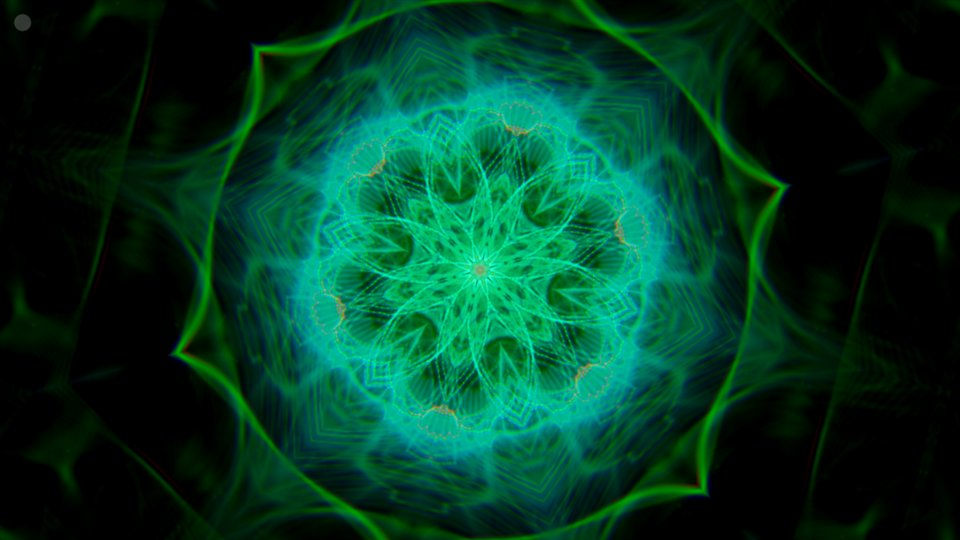
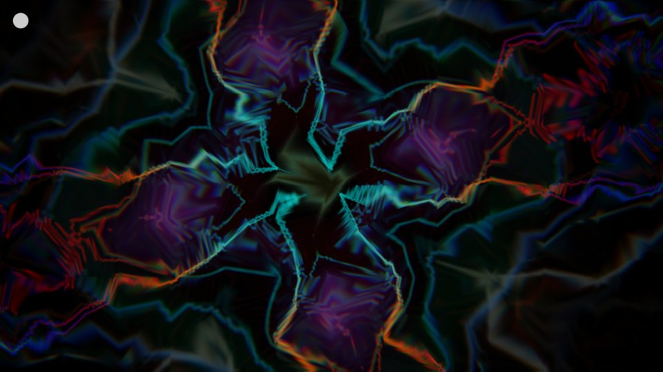
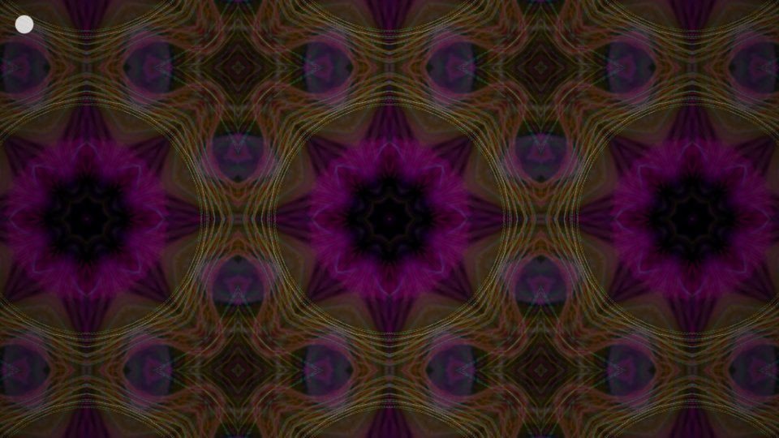
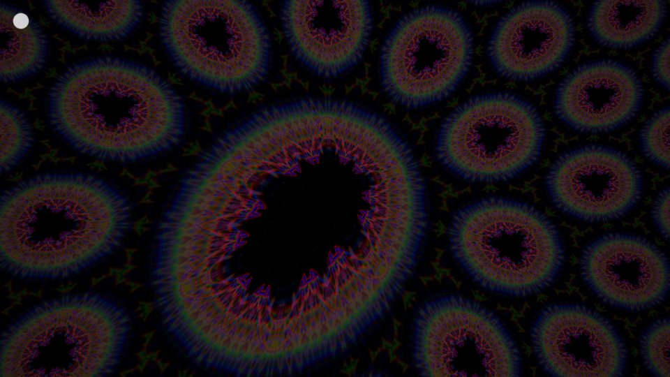

# Drift

> ⚠️ **Heads up:** this is AI vibe-coded (built with Claude) by a dumbass who has no idea what he's doing. Use at your own risk; no warranty, no promises.

A trippy music visualizer for Windows, in the spirit of the old Winamp-era feedback
visualizers. It listens to whatever Windows is playing and draws it with GPU feedback
effects: zooming, swirling trails, waveforms, kaleidoscopes and colour drift.

The look is never fixed. Every launch and every song starts from a fresh random look, at a
random level of complexity. Each song gets its own random mix of layers (spectrum ring,
swirl, tunnel rings, sparkles, orbs, chromatic split, echo) and abstract maths (fractal-flame
warps, complex-plane lenses, wallpaper tilings, curl-noise flow, superformula and Lissajous
shapes, strange attractors). The picture gets busier and calmer in no fixed order, so layers
fade in and out differently every time. The whole look keeps drifting. What the music does (a bass
drop, a build-up, a breakdown, the hi-hats coming in, a tempo change) decides what mutates.
When a song ends and a new one starts, a new "species" is born.

The app is dark throughout: title bar, controls, menus and scroll bars.



| Start of a song | A minute in | A few minutes in |
|---|---|---|
|  |  |  |

| Tunnel lens, p6m tiling, Clifford attractor | Bubble + polar flame, p4m tiling | Power lens, p3m1 tiling, Svensson attractor |
|---|---|---|
|  |  |  |

**Download:** [drift-viz.exe](https://trolanin.github.io/drift-viz/drift-viz.exe). It's a
single file with no installer. It needs 64-bit Windows 10 or 11 and a DirectX 11 GPU.
Windows SmartScreen may warn you because the file isn't signed. Click "More info", then "Run anyway".

## Windows

- **Settings window.** The settings sit on the left and the visualizer is docked on the right.
  Drag the divider between them to resize the settings column. The window itself resizes like
  any other.
- **Undocked.** Click "Undock visualizer", or double-click the docked picture. The visualizer
  then becomes its own borderless window with nothing but the picture and a faint dot in the
  top-left corner.
  - Drag the dot to move the window.
  - Drag any edge or corner to resize it.
  - Double-click the dot to fill the screen, and again to go back.
  - Right-click for a menu.
  - Closing it docks it back.
- **Visualizer size.** Type a width × height in the settings and click Apply. This works docked
  or undocked.
- **Grip dot opacity.** This slider sets how visible the dot is. It brightens when the mouse is over it.

## Keys (with the visualizer focused)

| Key | Does |
|---|---|
| F or F11 | Fill screen / leave fill screen |
| Esc | Leave fill screen |
| D | Dock / undock |
| M | Mutate now |
| N | New species (start over from a fresh random look) |
| L | Keep this look as a favourite |
| Space | Freeze / unfreeze evolution |

## Settings

| Setting | What it does |
|---|---|
| Listen to | "What Windows is playing" (loopback of your default output device), or a built-in demo beat |
| Reactivity | How hard the music pushes the motion |
| Evolution speed | How fast the look drifts, and how often it makes small changes |
| Mutation strength | How much a scene change alters |
| Max scene length | The longest a scene lasts before it mutates on its own |
| Complexity swing | Minutes for complexity to travel from calm to busy (it wanders both ways) |
| Max complexity | Caps how busy the picture can get |
| Freeze evolution | Holds the current look (it still reacts to the music) |
| Keep this look | Saves the look as a favourite. New species are sometimes bred from favourites. |
| Trails | Shorter or longer feedback trails |
| Brightness | Overall exposure. The picture also auto-adjusts so stacked layers don't wash out to white. |
| Render resolution | 50% / 75% / 100% of the window, for slower GPUs |
| Undocked window stays on top | Keeps the borderless window above other windows |
| Excessive options | Shows 83 more knobs, below. "Reset" puts just those back to their defaults. |

Hover over any setting to see what changing it does to the picture. Click a slider's value to
type an exact number: percentages in percent (`85` = 85%), everything else in the unit shown.
Enter or clicking away applies it, Esc cancels. Typed values are kept inside the slider's range.

Settings and favourites are saved in `%APPDATA%\DriftViz\`.

### Excessive options

Tick **Excessive options** at the bottom of the settings to open seven more groups:

| Group | What's in it |
|---|---|
| Audio analysis | Beat sensitivity and minimum gap, how big a change counts as a new section, event sensitivity, the silence level, how long a gap means a new song, spectrum fall-off and range |
| Mutate on audio events | For each musical event, how strongly it mutates and what it changes (see below). Also "every phrase" (a mutation every 8–64 beats), and a cooldown between event mutations. A line shows what has been heard so far. |
| Audio steers the drift | Each gene group (motion, colour, shape, layers, math, symmetry) can follow one feature of the music: loudness, bass, mids, treble, tone brightness, beat density or novelty. The louder that feature, the faster that group drifts. |
| Evolution engine | Drift damping, beat nudges, how many genes and switches change per scene, cross-fade and ease speeds, breeding from favourites, silence drain, the lowest complexity a new species can start at, and the latent mixing and Lorenz chaos amounts |
| Layer strengths | A multiplier for every layer (waveform, spectrum ring, tunnel, sparkles, orbs, attractor, echo, chromatic split, beat flash, kaleidoscope, mirror) |
| Math space | The math threshold (the average complexity where the maths comes in; each species varies it), how strongly each math family can apply, and the attractor's points, iterations and dot size |
| Fine look | Saturation, exposure target and auto exposure, vignette, colour cycling and drift speeds, zoom and spin bias, motion speed, line thickness, grip dot size, frame-rate cap |

### What the music can mutate

The analyser listens for these events, and each one can be pointed at a part of the look:
everything, motion, colour, shape, layers, math space, symmetry, or a whole new species.

| Event | Heard as | Changes by default |
|---|---|---|
| Music changes | The overall band-energy profile moves away from the last few seconds | everything |
| Bass drop | The bass falls well below its average, then comes back hard | motion |
| Build-up | Treble and level climb steadily for about 5 seconds | math space |
| Breakdown | The level falls well below its average without going silent | colour |
| Tone shift | The spectral centre of mass moves (darker or brighter sound) | colour |
| Hi-hats pick up | Onsets in the 5–16 kHz band suddenly come much more often | shape |
| Vocals / melody in | The mid band suddenly takes a bigger share of the energy | layers |
| Tempo change | A new steady tempo holds for 4 seconds | everything |
| Big hits | A beat several dB above the recent beats | symmetry |
| Every phrase | Every 8, 16, 32 or 64 beats (off by default) | everything |

## The math space

Each family is a choice that cross-fades between its two strongest options, so the
transitions are morphs rather than cuts.

- **Fractal-flame warp.** Two of 24 variations (sinusoidal, spherical, swirl, horseshoe,
  polar, heart, disc, spiral, bubble, fisheye and others) are applied after an affine
  transform inside the feedback loop. Their mix and the affine coefficients are genes.
- **Curl-noise flow.** A divergence-free flow field pushes the feedback, so trails curl
  without bunching up.
- **Complex lenses.** 12 maps of the view through the complex plane: power, inversion,
  Möbius, Droste spiral, tunnel, hyperbolic, twist, barrel, complex sine, Joukowski and
  polar unwrap.
- **Wallpaper tiling.** p4m, p6m, p3m1, bricks and a pinwheel tiling repeat the picture.
- **Superformula and Lissajous shapes** for the waveform, with their exponents and
  frequency ratios as genes.
- **Strange attractors.** Clifford, de Jong, Svensson and "dream" attractors are iterated on
  the GPU as tens of thousands of glowing points, blended between two families.

Together with the old layer choices this gives about 2.6 billion distinct combinations of
discrete choices, up from about 11,000, before counting the roughly 70 continuous genes.

## How the evolution works

- **Genes.** About 70 continuous parameters ("genes") cover zoom, rotation, swirl, warp,
  decay, palette, waveform shape, kaleidoscope, echo, the flame affine, lens and tiling
  parameters, the attractor coefficients and more. Each one wanders on a slow, damped random
  walk inside a range that widens as complexity grows. They are sorted into six groups
  (motion, colour, shape, layers, math space, symmetry) that audio events and steering act on.
- **Choices.** Discrete choices (waveform shape, number of copies, kaleidoscope folds, mirror
  mode, tunnel shape, flame variations, lens, tiling, attractor family) cross-fade between
  their two strongest options instead of popping.
- **Latent mixing.** Six slow hidden factors each pull on a sparse random set of genes, so
  genes from different groups sometimes move together. That makes coordinated changes that a
  per-gene random walk would almost never find. The loadings are re-rolled for every species.
- **Lorenz chaos.** A Lorenz attractor runs alongside, and its three coordinates nudge genes
  too. It never repeats and never settles, so the drift keeps finding new directions.
- **Complexity.** While music plays, complexity heads for a target that is redrawn at random
  moments, so it climbs and falls. Each species draws its own threshold for every layer and
  every option: some are there from the start, some come in at a random point, and some never
  appear in that species. The order is different every time. Complexity drains during silence.
- **Scene mutations.** A mutation happens when the analyser hears one of the events above,
  or when the scene timer runs out (after a random part of "Max scene length", on a random
  handful of groups, at a random strength). Each event changes only the genes and choices of its
  target group, so a bass drop can shake up the motion while the colours stay put. Beats add
  small nudges.
- **New species.** After more than 4 seconds of silence (a new song), a new species is born at
  a random complexity. Half the time it is bred from your kept favourites, by crossover plus a little mutation.

## Building

You need Visual Studio 2022 or its Build Tools, with the C++ workload and a Windows 10/11 SDK.
Then run:

```
build.bat
```

It compiles the shaders with `fxc` into `build\`, then builds `drift-viz.exe` with `cl`
(static CRT, no dependencies beyond Windows). Plain C++17, Win32, Direct3D 11 and WASAPI.
It has no frameworks.

| File | What's in it |
|---|---|
| `src/main.cpp` | Windows, dark-mode settings UI (custom-drawn buttons and sliders), docking, borderless window, keys, settings file |
| `src/options.cpp` | The table of excessive options: labels, ranges, defaults and settings-file keys |
| `src/render.cpp` | Render thread: D3D11 setup, feedback buffers, attractor pass, frame pacing, screenshots |
| `src/shaders.hlsl` | Warp/feedback pass (flame variations, curl flow), waveform lines, attractor points, composite (lenses, tiling, kaleidoscope, echo, tone map) |
| `src/evolve.cpp` | The evolution engine (genes, choices, latent factors, Lorenz drift, event triggers) and the mapping from genes and audio to shader parameters |
| `src/audio.cpp` | WASAPI loopback capture, FFT analysis, beat / section / silence detection, musical event detection, demo beat |
| `src/params.h` | Shader parameter slots shared by C++ and HLSL |

### Command-line options (for testing)

| Option | Does |
|---|---|
| `--demo` | Use the built-in demo beat |
| `--docked` / `--undocked` | Start docked or undocked |
| `--size WxH` | Visualizer size in pixels |
| `--evo-scale K` | Run the evolution K times faster |
| `--shot file.png` | Save a screenshot and quit. Starts without taking focus, and implies `--no-save`. |
| `--shots N --after S --every S` | Take N screenshots: the first after S seconds, then one every S seconds (`file-1.png` …) |
| `--log path` | Append fps, audio and evolution state once a second |
| `--no-save` | Don't write settings on exit |
| `--excessive` | Start with the excessive options shown |
| `--scroll-more` | Start with the settings scrolled to the excessive options |
| `--set key=value` | Set one excessive option, e.g. `--set x.mGate=0` (keys as in `settings.ini`) |
