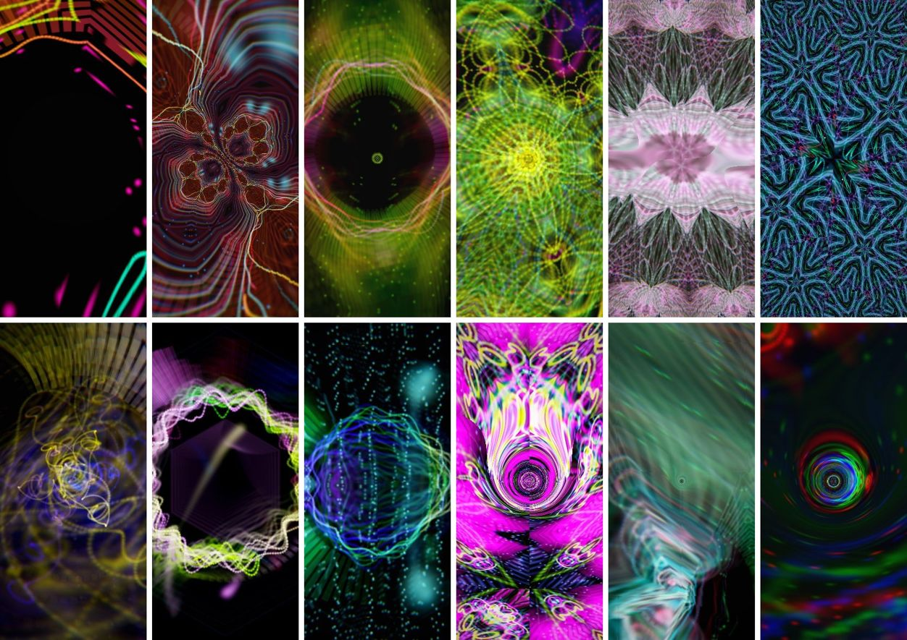

# Drift for Android

> ⚠️ **Heads up:** this is AI vibe-coded (built with Claude) by a dumbass who has no idea what he's doing. Use at your own risk; no warranty, no promises.

A quick phone version of the [Drift](../README.md) music visualizer. It has the same four GPU passes as the
Windows app, ported to OpenGL ES 3.0: feedback warp, waveform lines, a strange attractor and the composite.
The evolution is a smaller version of the desktop engine. Each look drifts on its own, layers come and go as
complexity wanders, and musical events (beats, drops, hi-hat rushes, big hits, section changes) mutate parts
of the look. Four seconds of silence starts a new species. Like the desktop app, it measures the picture's
brightness on the GPU and pulls the trails and exposure back, so stacked layers don't wash out to white.

It needs Android 10 or newer.

*Frames from two species on the demo beat, rendered from the app's own shaders and evolution code (through WebGL2 on a PC, not on a phone).*

## Using it

The app opens full screen. A built-in demo beat drives the visuals at first; it's silent, so you won't hear it.
Tap anywhere to show or hide the panel:

| Button | Does |
|---|---|
| Phone audio | Visualizes whatever other apps play. Android shows its screen-sharing prompt because that's how it grants sound capture. No video is recorded. Some apps block capture of their sound (Chrome is one); music apps like YouTube Music and Spotify usually allow it. |
| Microphone | Visualizes the room through the mic. |
| Demo beat | Back to the silent built-in groove. |
| New look | Starts a new species now. |

## What's left out compared to Windows

There are no settings, favourites or excessive options. The math space is smaller: 14 flame variations, 8 lenses and 5 tilings. There's no superformula wave, and no latent factors or
Lorenz drift. The audio analysis keeps beats, hits, drops, hi-hat rushes, section changes and silence.

## Building

Run `build-apk.ps1` on the PC. It uses the plain SDK tools (aapt2, javac, d8, zipalign, apksigner) with no Gradle,
like the LED Audio app, and writes `..\drift.apk`. The signing key `drift-release.jks` is created in
`D:\Claude Misc\android` on first build and stays out of this public repo. Keep it, or phones won't accept updates.

The code uses no lambdas, because the build compiles against android.jar, which can't support them.

| File | What's in it |
|---|---|
| `MainActivity.java` | Full-screen GL view, the tap panel, permissions and the screen-sharing prompt |
| `DriftRenderer.java` | GLES 3.0 setup, ping-pong feedback buffers (half-float when the GPU allows), the four passes |
| `Shaders.java` | GLSL ES ports of `src/shaders.hlsl` |
| `Params.java` | Shader parameter slots. The GLSL `#define`s are generated from these fields. |
| `Evolver.java` | Genes, layers, choices, event mutations and the mapping to shader parameters |
| `Analyzer.java` | FFT, spectrum, levels and the beat, hit, drop, hi-hat and section detectors |
| `AudioIn.java`, `CaptureService.java` | The sound sources: demo, microphone, or playback capture through a MediaProjection |
| `DemoSynth.java` | The silent demo groove: 124 BPM, with a breakdown, a riser and a drop every 64 beats |

`Params`, `Shaders`, `Analyzer`, `DemoSynth` and `Evolver` use no Android classes, so they also run on a desktop JVM.
That's handy for testing the detectors, or for rendering the shaders through WebGL2, which uses the same GLSL ES 3.00.
