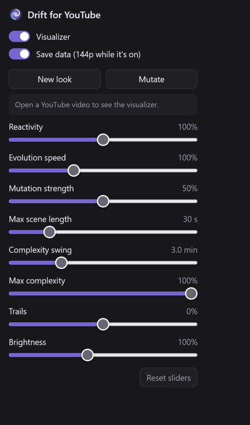

# Drift for YouTube (Firefox add-on)

> ⚠️ **Heads up:** this is AI vibe-coded (built with Claude) by a dumbass who has no idea what he's doing. Use at your own risk; no warranty, no promises.

The Drift visualizer as a Firefox add-on. On a YouTube video page it covers the
picture with Drift, driven by the video's own sound. The player controls, captions and
menus stay on top and work as usual. The sound is not changed.

With **Save data** on (the default), the add-on holds the player at its lowest quality
(144p) while the visualizer covers it, because nobody can see the picture anyway. When you
switch the visualizer off, the player goes back to automatic quality.

On a test video, the add-on cut the downloaded data by about three quarters:

| | Video | Data rate |
|---|---|---|
| Visualizer on | 144p | about 300 kbit/s (sound plus a tiny picture) |
| Visualizer off | 1080p | about 1,160 kbit/s |

The saving is bigger on busy videos, because they need more data at high quality.

## Installing

Firefox only keeps add-ons that Mozilla has signed. This one isn't signed yet, so for now
you load it for one browser session:

1. Download or clone this repository.
2. In Firefox, open `about:debugging#/runtime/this-firefox`.
3. Click **Load Temporary Add-on…** and pick `firefox/manifest.json`.

It stays loaded until Firefox closes. Firefox Developer Edition and Nightly can keep it
permanently: set `xpinstall.signatures.required` to `false` in `about:config`, then zip the
`firefox` folder's contents and install the zip from `about:addons`.

## Using it

- Open any YouTube video. The visualizer starts by itself.
- If a note asks you to, click the page once. Firefox only lets a page's sound be
  analysed after you have clicked or pressed a key on it.
- **Alt+Shift+V** switches the visualizer on and off. The toolbar button does the same,
  and has the other controls.

The toolbar popup has:

- **Visualizer**: on or off.
- **Save data**: hold the video at 144p while the visualizer is on.
- **New look** starts a new species. **Mutate** changes the current look.
- A status line: frame rate, whether the sound is connected, the tempo, and the video quality.
- The same sliders as the desktop app: reactivity, evolution speed, mutation strength,
  scene length, complexity swing, max complexity, trails and brightness.

## How it works

- The add-on routes the video's sound through the Web Audio API on its way to the
  speakers and reads the samples there. It analyses them every 10 ms, the same way as the
  desktop app: the spectrum, beats, tempo, build-ups and drops.
- The evolution and the shaders are ports of the desktop app's code, drawn with WebGL 2.
- The add-on sends nothing anywhere. It only runs on youtube.com and only stores your
  settings, in Firefox.

## Limits

- It needs WebGL 2 with half-float render targets. Any GPU from the last ten years has them.
- The 144p picture still downloads, because YouTube's player won't play the sound without
  loading a picture too. It is small, but it isn't nothing. A true sound-only mode may come later.
- YouTube changes its player often. If an update breaks the quality lock, the add-on leaves
  the quality alone and still draws.
